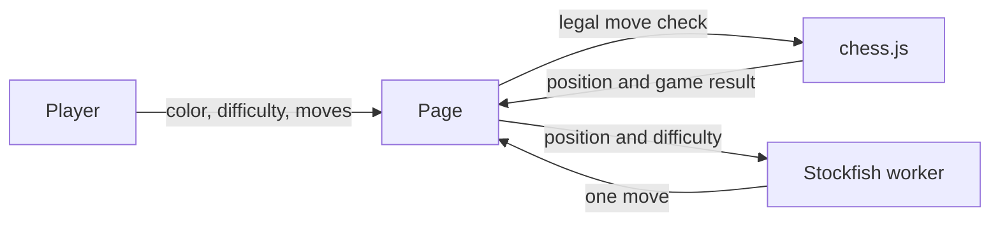

# Chess vs AI

A single web page where one person plays a legal chess game against Stockfish. The player picks a color and a difficulty, plays until the game ends, and can start over.

## Goal

The player can finish a real game of chess against an opponent with three distinct strengths. Easy should hang pieces. Medium should punish obvious mistakes. Hard should beat a casual player who is not being careful.

This version is one local page. It has no account, no server, and no saved games.

## Out of scope

Clocks, undo, a move list, game export, human-versus-human play, hints, and opening books.

## Stack

- Vite, React, and TypeScript for the page.
- chess.js is the only rules authority.
- The `stockfish` npm package, lite single-threaded build: `stockfish-19-lite-single.js` and `stockfish-19-lite-single.wasm` (about 1.7MB). These files are served from `public/` so the worker URL is `/stockfish-19-lite-single.js` and the wasm file sits beside it. This build needs no cross-origin isolation headers.
- `react-chessboard` for drag, click, highlights, orientation, and the promotion picker.
- Vitest for the automated tests. Those tests never launch the real engine.

A footer on the page reads: `Opponent: Stockfish (GPL-3.0)`.

## Architecture

Three pieces do the work.

**Page.** It owns setup, the board, the status line, and New Game. Each game has its own chess.js instance, started from the standard initial position. Every move is applied to that instance, so the game keeps the history threefold repetition and the fifty-move rule need. New Game throws that instance away. The page sends the worker the current FEN only. The worker never writes the board.

**chess.js.** It accepts or rejects a move and reports check and the ending. A move that chess.js rejects does not change the game.

**Stockfish worker.** One worker is created when the page loads and lives until the page closes. It runs one thread with a 16MB hash, set once after `uci` with `setoption name Threads value 1` and `setoption name Hash value 16`. It returns one move per request.

Each request carries an increasing id. A reply whose id is not the latest is ignored. New Game sends `stop`, drops the current id, and returns to setup. Every game, including the first, begins with `ucinewgame` so the engine does not keep an earlier game.

If the player chose Black, the worker moves first after Start. The board is oriented so the player's pieces sit at the bottom: `white` when the player is White, `black` when the player is Black.

## Screen

The page has two modes.

**Setup.** The board shows the starting position and ignores moves. The player picks White or Black, then Easy, Medium, or Hard, and can change both choices until pressing Start. Start stays disabled until the worker is ready. While the worker is still loading, the status line is empty. After Start, the color and difficulty stay fixed until New Game.

**Game.** A piece moves by a drag, or by a click on a piece and then a click on a destination. After a piece is selected, the squares it can legally move to are highlighted. The origin and destination of the last move stay highlighted.

One status line, in this order:

1. The result, when the game is over.
2. `Stockfish stalled.` when the engine has failed during a game.
3. `Stockfish is thinking.` while a search is in flight.
4. `Check.` when it is the player's turn and their king is in check.
5. `Your turn.` when it is the player's turn and they are not in check.

That order applies during a game. During Setup the status line is empty, unless loading failed, in which case it is `The opponent failed to load.`

The board ignores input while Stockfish is thinking, after the game ends, and after the engine stalls. New Game is available once a game has started, including while the engine is thinking and after the game ends. New Game discards the position and returns to Setup.

Clicking a second piece of the player's own color selects that piece instead of moving. When a player's pawn reaches the last rank, a picker offers queen, rook, bishop, and knight. The move is not applied until the player chooses. Closing the picker without a choice snaps the piece back and leaves the FEN unchanged. An engine promotion uses the piece letter in the engine move and shows no picker.

## Rules and endings

chess.js supplies the rules: castling, en passant, promotion, check, checkmate, stalemate, threefold repetition, insufficient material, and the fifty-move rule. The player can move only their own pieces, and only on their turn.

The result line is exactly one of:

- `Checkmate. White wins.`
- `Checkmate. Black wins.`
- `Stalemate.`
- `Draw by threefold repetition.`
- `Draw by insufficient material.`
- `Draw by the fifty-move rule.`

Checkmate is decided first. Among draws, the order is stalemate, threefold repetition, insufficient material, then the fifty-move rule.

## Difficulty

The player sees the names Easy, Medium, and Hard. The worker sets `Skill Level` before each search, sends `position fen <fen>`, then the `go` command, and reads `bestmove`.

- Easy: Skill Level 0, `go depth 2`. A beginner. It hangs pieces and misses anything longer than a short tactic.
- Medium: Skill Level 8, `go movetime 250`. A club player. It punishes obvious mistakes and still thinks briefly.
- Hard: Skill Level 20, `go movetime 800`. Full strength at a short think.

The engine client parses `bestmove` and the page applies that move through the game module. A move such as `e7e8q` includes the promotion. Extra UCI tokens, including `ponder`, are ignored. `bestmove (none)` is not a move. A line that is not `bestmove` followed by a move is not a move.

## Failures

- If the worker fails to load or errors on startup, Setup stays visible, Start stays disabled, and the status line is `The opponent failed to load.` Refreshing the page is the recovery.
- A worker error after a game has started is a stall: the position stays unchanged, the status line is `Stockfish stalled.`, and the board locks.
- An illegal drop or click snaps the piece back. The FEN does not change.
- Moves are ignored while a search is in flight and after the game is over.
- New Game during a search sends `stop`. A later reply for the old id does not change the position.
- If a `bestmove` is not a legal chess.js move, it is not applied. The page asks the worker once more for the same position and the same difficulty. If that second reply is also illegal, the status line is `Stockfish stalled.` and the position is unchanged.
- If a search produces no usable `bestmove` within 5 seconds of `go`, the page sends `stop`, shows `Stockfish stalled.`, and leaves the position unchanged. A timeout does not retry. Each search has its own 5 seconds, and the retry is a separate search.
- After a stall the board stays locked. New Game is the way back to Setup.

## Tests

Automated tests use Vitest and do not start Stockfish.

- Easy maps to skill 0 and `go depth 2`. Medium maps to skill 8 and `go movetime 250`. Hard maps to skill 20 and `go movetime 800`.
- A UCI move, including a promotion, becomes the matching chess.js move.
- A position where White has checkmated Black produces `Checkmate. White wins.` A position where Black has checkmated White produces `Checkmate. Black wins.` A stalemate position produces `Stalemate.` One fixture each produces `Draw by threefold repetition.`, `Draw by insufficient material.`, and `Draw by the fifty-move rule.`
- An illegal player move leaves the FEN unchanged.
- A reply whose id is not the latest leaves the position unchanged.
- The line `bestmove e2e4 ponder e7e5` parses to `e2e4`. `bestmove (none)` does not parse to a move. A line that is not a `bestmove` line does not parse to a move.

After the app exists, a person checks four things in the browser: a game as White, a game as Black, a pawn promotion, and New Game while Stockfish is thinking.

## Boundaries

- `difficulty` maps a level name to a skill value and a `go` command. It depends on nothing else.
- The UCI parser turns one engine line into a move or nothing. It depends on nothing else.
- The game module applies a player move or an engine move to a chess.js game and returns the next status. It depends on chess.js. It does not parse UCI, choose a difficulty, or talk to the worker.
- The engine client owns the worker, request ids, the 5 second timeout, and `stop`. It uses the UCI parser. One search returns a move or a failure. It does not decide whether that move is legal, and it does not retry.
- The page depends on the game module and the engine client. When the game module rejects an engine move, the page requests one more search for that same position. The board component draws a FEN and reports a requested move. It does not decide legality.
